# EasyOLT

一款面向 OLT（光纤线路终端）设备的 Web 集中运维平台。平台经 SSH / Telnet（支持 SSH 跳板机 direct-tcpip 隧道，无需额外跳板工具）登录设备 CLI，将板卡 / PON 口 / 聚合口 / VLAN / 模板 / ONT 注册与业务流等日常运维命令全部网页化；同时支持设备台账与在线监控、批量运维、WebSSH 终端、环路检测、MAC 地址表查询、设备侧用户管理与多渠道告警推送。

系统只有两种角色：**管理员**（全部功能）与**审计员**（仅查询）；下文未标注的写操作均为管理员专用，查询类功能对所有登录用户开放。

## 功能特性

### 平台管理
- 首次访问自动进入初始化向导，创建管理员账户（不内置任何默认账号）
- 支持仪表盘总览：设备在线统计全员可见；用户 / 登录统计、近 7 天登录趋势、角色分布仅管理员可见
- 支持用户管理：创建用户、角色分配（管理员 / 审计员）、启用/禁用、重置密码、删除与批量删除、关键字 / 角色 / 状态筛选（管理员专用）
- 支持登录日志审计：用户名 / 结果 / 日期区间筛选与清空（管理员专用）
- 支持算术验证码登录、按 IP+用户名连续 5 次失败锁定 10 分钟、会话超时、修改密码强度指示与修改后强制重新登录
- 支持自定义入口管理：按账号开关左侧业务模块显隐，配置存服务端、跨浏览器生效
- 支持顶栏「检查更新」（对比 GitHub Releases 最新版本）、「停止服务」（管理员专用）、浅色/暗色主题切换与全屏

### OLT设备管理
- 支持登记 OLT 设备：SSH / Telnet 协议、端口、账号 + 密码或私钥认证、品牌 / 型号；设备凭据加密落盘，编辑时凭据留空即沿用旧值
- 支持 SSH 跳板机（地址 / 端口 / 账号 + 密码或私钥，私钥支持口令）：开启后所有采集 / 运维 / 批量运维 / Web 终端均经跳板机隧道转发
- 支持每设备独立在线监控开关：ICMP Ping 探测（跳板设备自动改为经隧道探测端口），采集间隔与 Ping 包数可配，离线 / 恢复自动触发告警推送
- 支持单台保存配置（save 并同步备用主控）、导出运行配置（txt 下载）、重启设备（前端三重确认）
- 支持批量运维：勾选多台执行批量保存配置 / 批量导出配置（完成后打包 ZIP 下载）/ 批量重启 / 批量删除，后台逐台执行、进度弹窗实时展示，关闭页面任务不中断、重进自动恢复进度
- 支持设备台账 Excel 导出（不含密码）与批量导入（仅新增，IP+端口判重）
- 支持浏览器内 WebSSH 终端操作设备（SSH / Telnet 通用）

### OLT用户管理
- 支持实时查询设备侧 CLI 登录用户：权限级别 / 状态 / 同账号在线数 / 用户模板 / 用户名与密码失效时间等
- 支持查询设备本地被锁定用户（锁定时间 / 原因）与登录失败记录（来源 IP / 失败次数等）
- 支持添加用户、删除用户、修改密码、设置最大登录用户数（管理员专用）
- 内置保护：root 禁止删除；EasyOLT 登录本设备所用账号禁止删除 / 修改密码

### 板卡管理
- 支持登录设备逐框采集机框与板卡信息（主控板 / PON 业务板 / 电源板类型识别）
- 支持查看单板运行状态详情
- 支持板卡注册（confirm）/ 禁用 / 删除 / 解除禁用（管理员专用）

### PON口管理
- 支持本地快照秒开，点击「采集」登录设备更新（依次查询全部 PON 业务板）
- 支持 PON 口位置区域编辑、Excel 导出 / 导入（导入仅更新既有口的位置字段，不新增）
- 采集与位置维护对所有登录用户开放

### 聚合口管理
- 支持采集链路聚合口与成员端口（联动板卡信息展示型号 / 速率 / 链路状态）
- 支持创建聚合组 / 添加成员 / 删除成员 / 删除聚合组（管理员专用）

### VLAN管理
- 上联口VLAN：采集全局 VLAN 表与上联口 VLAN 成员 / Native VLAN；全局 VLAN 自定义备注（联动显示在上联口标签、MAC 地址表与 ONT 业务流处）；支持创建 / 删除 VLAN（批量区间）、上联口放行 / 取消放行（管理员专用）
- VLAN互通：创建互通模板（user-bridging enable + commit）并绑定 VLAN，实现板间 / 板内同 VLAN 用户互通（打印机共享、哑终端等场景）；模板详情展示全部参数与绑定 VLAN 列表；支持创建模板 / 绑定 / 解绑 / 删除（管理员专用，绑定解绑耗时数分钟，删除前自动预检绑定）

### 模板管理
- DBA模板：读取全部上行带宽模板（类型 / 固定 / 保证 / 最大带宽 / 绑定次数）；支持新增（type1-5 按类型动态配置）与删除（管理员专用）
- ONT线路模板：读取 GPON / EPON 线路模板及绑定次数，详情含 T-CONT / DBA 绑定、GEM 队列与 VLAN 映射；支持新增 GPON 线路模板、删除 GPON / EPON 线路模板（管理员专用，操作后自动校验）
- ONT业务模板：读取 GPON / EPON 业务模板，详情含端口能力、全局参数与各端口业务配置；支持新增（POTS / ETH 端口自适应、环路检测、组播转发模式）与删除（管理员专用）

### ONT管理
- 整板管理：本地快照秒开，框 → 板 → 口 → ONT 逐级下钻；采集支持全框 / 按板 / 按口三种粒度，增量合并入快照；在线 / 离线统计、Rx/Tx 光功率分级着色、SN / 描述 / 型号 / 位置多条件搜索
- ONT 详情分页签：基本信息（温度 / CPU / 内存）、线路 / 业务模板、注册及业务流、ETH / WAN / WLAN / 已学习 MAC
- 支持添加 ONT（SN 认证 + 模板绑定 + 可选 ETH VLAN）、删除 / 整口删除、重启、禁用 / 启用、替换（改 SN 保留配置）、修改描述、ETH 网口配置、按预设下发业务流与业务流检查 / 一键修正（管理员专用）
- 支持批量运维：批量修改描述、静态预注册、业务流下发 / 删除 / 检查（单任务 ≤300 台，后台执行、可取消、切页可恢复进度，检查可导报告并选择性修正）
- 支持 Excel 导出全部 ONT、导入批量修改描述、导入静态预注册（解析预览后执行）
- 实时快管：按 SN / 描述 / LOID / IP / MAC 实时登录设备查找（不依赖快照），行内重启 / 禁用 / 启用 / 替换 / 改描述 / 删除，过滤结果 Excel 导出
- 自动发现注册：实时查询 GPON 口待注册终端（SN / 厂商 / 型号 / 软件版本 / MAC 等全部字段）；批量开 / 关全部 PON 口自动发现；一键注册（绑定预设、自动分配 ONT-ID 并配置 ETH / 业务流）；待注册清单 Excel 导出 / 导入注册
- 注册预设配置：按设备保存注册模板于平台数据库（业务 / 线路模板、ETH 口 VLAN、业务流 GEM↔VLAN 映射），供一键注册与批量业务流使用；支持粘贴 ONT 配置回显解析、从已注册 ONT 实时读配置生成预设、命令预览（管理员专用）

### 环路检测管理
- 支持实时读取环网检测配置状态（用户侧 / 网络侧 / 级联侧开关、EtherType、自动激活间隔、trap 通知方式）、检测记录（待自动激活倒计时）与 ONU 单次检测报告（最多 16 条循环覆盖）
- 支持开关三侧检测、启动 / 停止 ONU 单次检测（可选框/槽与时长）、设置 / 取消自动激活间隔、修改检测报文 EtherType（须全部检测去使能）、设置 trap 通知方式（须用户侧去使能）（管理员专用）

### MAC地址表
- 支持快照秒开与手动采集（display mac-address all，约 1-2 分钟）
- 支持关键字搜索（MAC 兼容 - / : / . 任意分隔格式与片段匹配，亦匹配位置 / VLAN / 服务流索引）、类型 / VLAN 筛选、MAC 总数统计
- 支持当前快照 Excel 导出（所有登录用户）

### 告警推送
- 支持设备离线 / 恢复在线事件推送，每渠道独立勾选「离线告警 / 恢复通知」并启用 / 停用，恢复通知含离线时长
- 支持企业微信 / 钉钉 / 飞书 / Server酱 / PushPlus / WxPusher / Bark / ntfy / Telegram / Slack / 邮件(SMTP) / 通用 Webhook 共 12 种推送渠道
- 渠道配置加密存储，支持未保存配置试发与已保存渠道行级测试（管理员专用）
- 支持推送记录查询：事件 / 成功失败 / 关键字 / 日期范围筛选，失败原因回显；自动保留最近 1000 条，清空仅管理员

## 快速开始

### 环境要求

- Windows10 及以上版本的操作系统（单文件 exe 双击即用，无需安装 Python / Node），或 Linux 服务器 / Docker 环境
- 平台需能访问 OLT 设备的 SSH / Telnet 管理端口（启用跳板机时只需能访问跳板机）
- OLT 设备需开启 SSH 或 Telnet 管理（华为系 CLI 命令风格，如 MA5800 等机型）

### 启动方式（三选一）

1. **单文件 exe（推荐）**：双击 `EasyOLT.exe` 自动启动服务并打开浏览器；数据库 `easyolt.db` 生成在 exe 同目录，备份只需拷走 exe + db 两个文件；再次双击若服务已在运行则直接打开页面
2. **Docker（Linux / NAS）**：

```bash
docker run -d --name easyolt -e PORT=8765 -v /path/to/data:/app/data --network host --restart=unless-stopped easyolt:latest
```

数据持久化在 `/app/data` 卷（easyolt.db / 密钥 / runlog），时区固定 Asia/Shanghai，容器内置 ping 用于在线监控。

### 命令行参数

```
用法: python run.py [-a] [-h] [-p PORT] [-4] [-6] [--help]

选项:
  -a, --auto-start  注册开机自启动（仅 Windows）
  -h, --hide        隐藏窗口静默运行（日志写入 runlog 文件）
  -p, --port PORT   Web 监听端口号（默认 8765）
  -4                仅监听 IPv4
  -6                仅监听 IPv6
  --help            显示帮助信息

环境变量:
  EASYOLT_PORT      Web 监听端口号（优先级高于 PORT）
  PORT              Web 监听端口号（Docker 常用 -e PORT=xxxx 覆盖）
  EASYOLT_APP_DIR   数据目录（easyolt.db / 密钥 / runlog 所在目录，Docker 挂载用）

注: 若不指定 -4 和 -6，或同时指定 -4 -6，则同时监听 IPv4 和 IPv6
```

## 使用流程

1. **初始化平台**：首次部署后访问 Web 页面，按引导创建管理员账户并登录
2. **添加 OLT 设备**：在「OLT设备管理」页面登记设备并配置 SSH / Telnet 与跳板机参数，开启在线监控确认可达，可用 WebSSH 终端验证登录
3. **配置告警推送**（可选）：在「告警推送管理」页面添加推送渠道并发送测试，勾选离线 / 恢复事件
4. **执行业务运维**：按需在「板卡 / PON口 / 聚合口 / VLAN / 模板 / 环路检测」页面完成采集与配置；新 ONT 放装推荐「注册预设配置」+「自动发现注册」一键注册，存量终端用「整板管理」采集维护
5. **日常查询**：仪表盘查看设备在线概况，「实时快管 / MAC地址表」定位终端，「登录日志 / 推送记录」审计追溯

## 运行截图

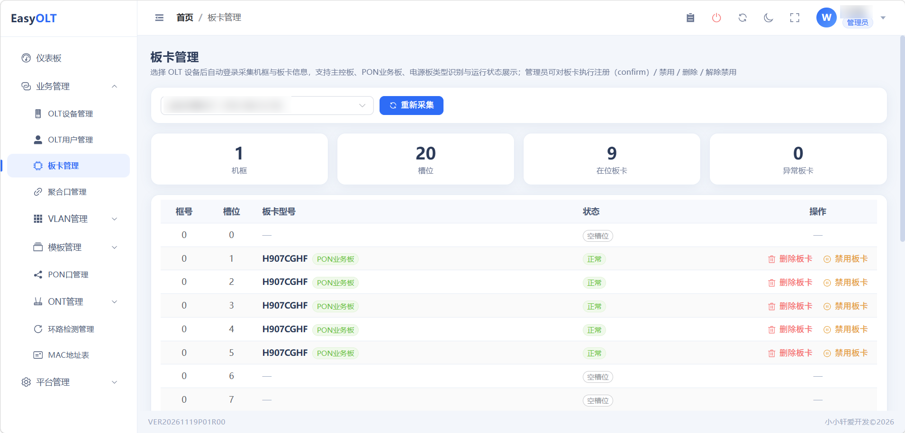

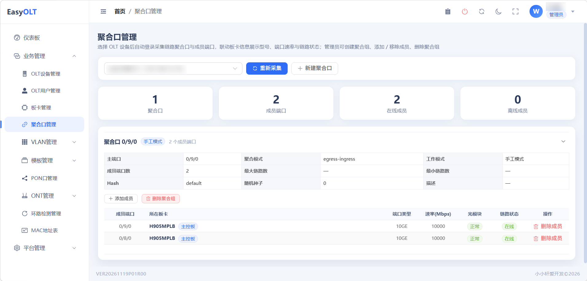

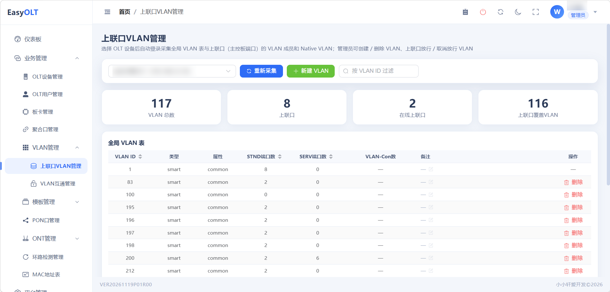

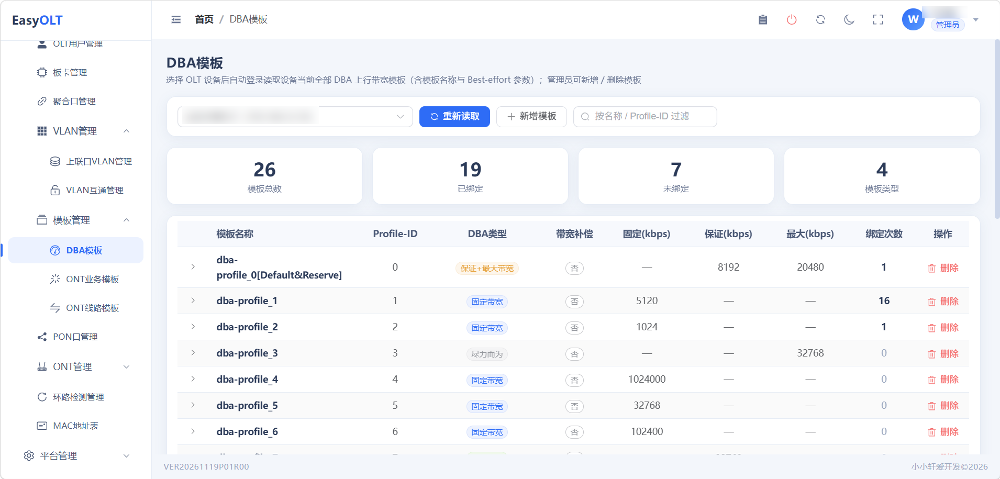

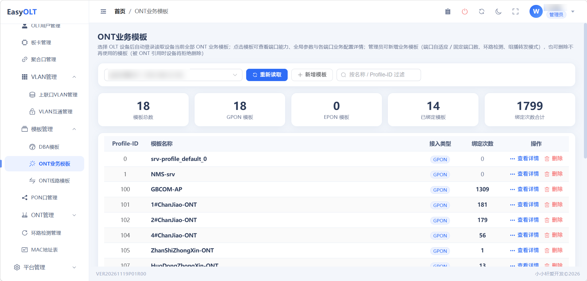

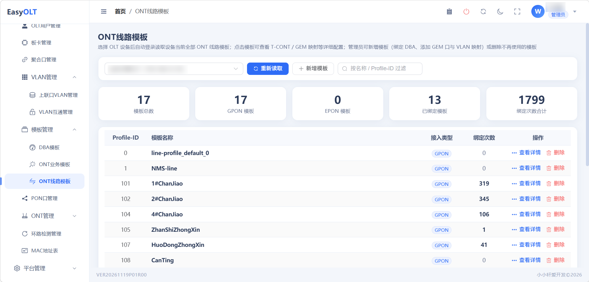


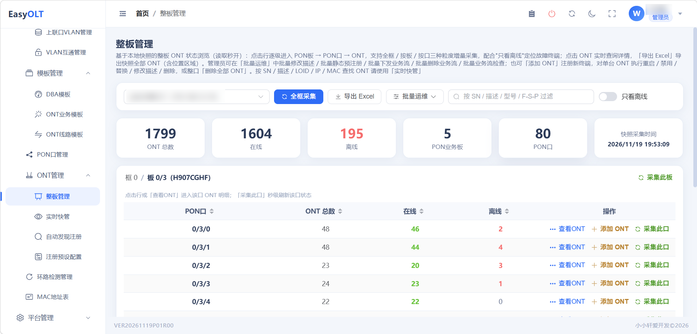

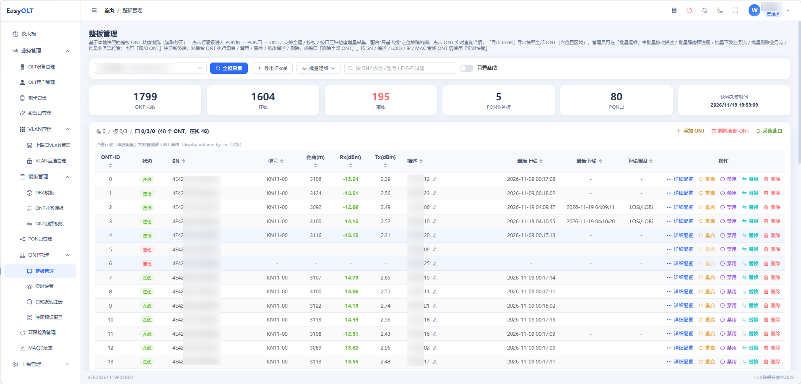

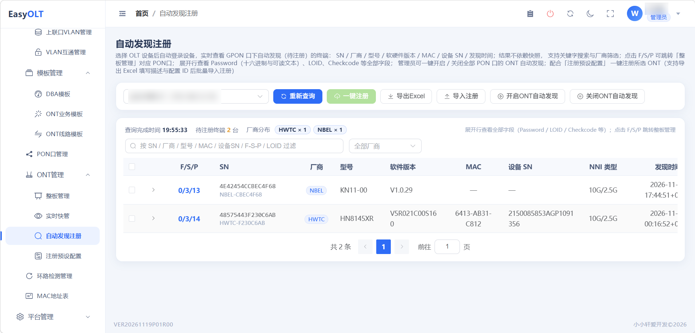

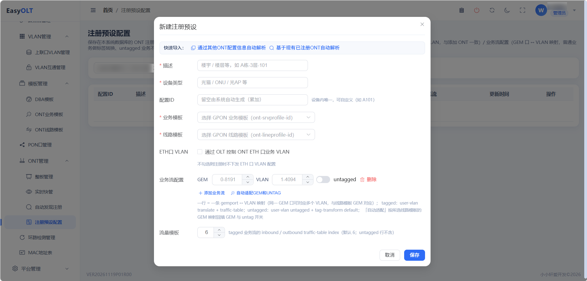

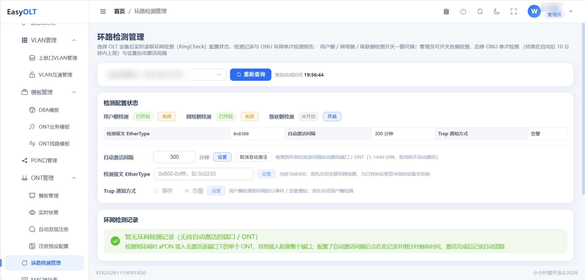

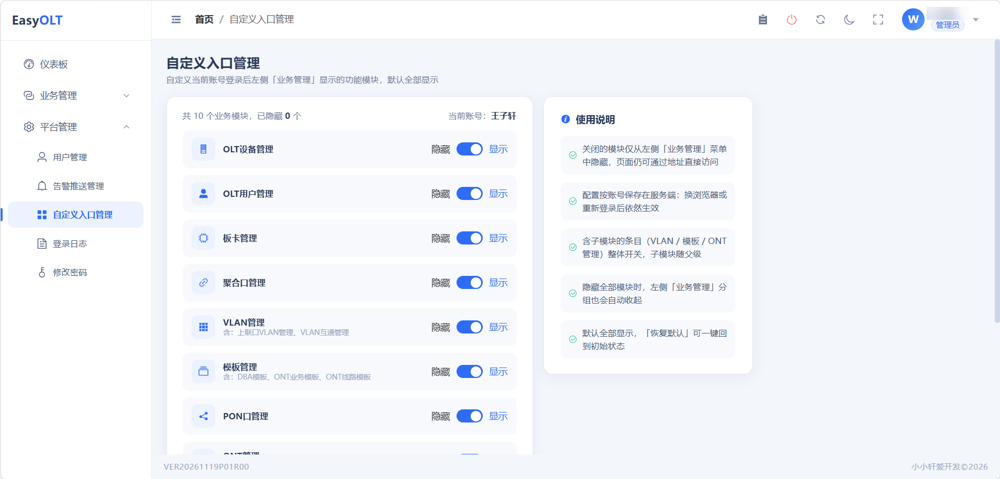

